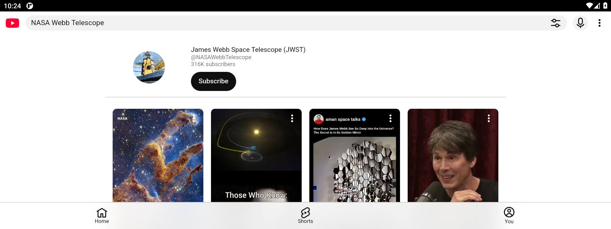

# YouTube Web

**Языки интерфейса** · Русский, English · [English README](README_EN.md)

Приложение-компаньон [Open Voyah Controls](https://github.com/siarheisinelnikau/open-voyah-controls) для просмотра YouTube на мультимедийном экране Voyah.

- Открывает мобильный YouTube в системном WebView. Сервисы Google Play не нужны.
- Поддерживает полноэкранное видео, медиакнопки и управление из музыкального виджета Open Voyah Controls.
- Отображается отдельной плиткой. Ширина окна, масштаб интерфейса и выбор экрана настраиваются через Open Voyah Controls.
- Ставит видео на паузу, когда окно скрывается.

[Лицензия GPLv3](LICENSE)
