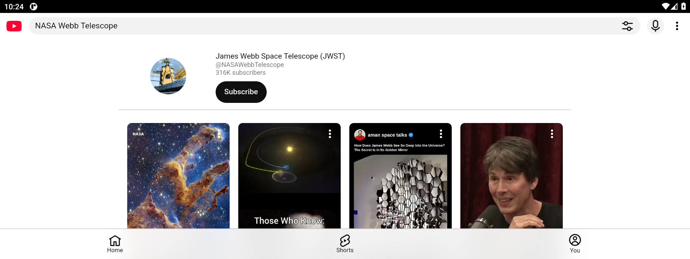

# YouTube Web

**Interface languages** · English, Русский · [Русский README](README.md)

A companion app for [Open Voyah Controls](https://github.com/siarheisinelnikau/open-voyah-controls) that brings YouTube to the Voyah head unit.

- Opens mobile YouTube in the system WebView without requiring Google Play services.
- Supports full-screen video, media buttons, and playback controls in the Open Voyah Controls music widget.
- Appears as its own tile. Set the window width, interface scale, and display in Open Voyah Controls.
- Pauses playback when the window is hidden.

[GPLv3 license](LICENSE)
